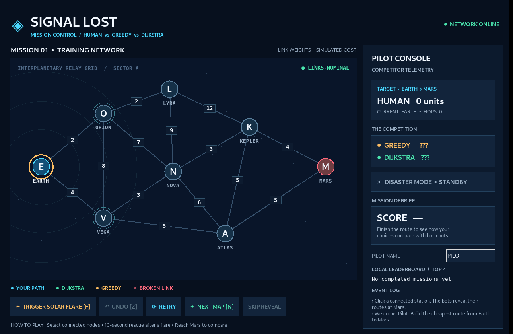

# SIGNAL LOST: MISSION CONTROL
### Human vs Greedy vs Dijkstra — a Python hackathon game



**The challenge:** Route a message from Earth to Mars through a damaged relay network. The human chooses each hop; greedy always picks the cheapest next edge; Dijkstra uses `heapq` to find the globally lowest-cost route. The game compares all three and explains the first difference. Randomized missions introduce a 10-second solar-flare recovery challenge.

## Play on Windows

1. Download and unzip the project.
2. Open the extracted `Signal_Lost_Mission_Control` folder.
3. **Double-click `RUN_GAME.bat`**, or open a terminal inside the folder and run:

   ```powershell
   py main.py
   ```

   If `py` isn't installed, try `python main.py`.

**Requirements:** Python 3.9+ with Tkinter (`py -m tkinter` tests it). No pip packages, no accounts, no keys, and no internet access necessary. On macOS/Linux, run `python3 main.py` if Tkinter is installed.

## Play the training map

- Click **VEGA → ATLAS → MARS** for an optimal route worth **14 units**.
- Click **ORION → LYRA → NOVA → KEPLER → MARS** to reproduce greedy's **20-unit** route.
- When you reach Mars, Dijkstra's node-by-node exploration animates in **purple**; the final routes appear in **cyan** (human), **orange** (greedy), and **green** (Dijkstra).
- Click **TRIGGER SOLAR FLARE** while you're playing to break a link on the best remaining route and start a **10-second** countdown. The bots restart from your current station, using exactly the same damaged graph and frozen earlier path. You must reach Mars before time runs out.
- Click **NEXT MAP** for a randomized network. On missions 2+, a solar flare automatically triggers after your second successful hop, if a solvable reroute exists.

The **score** is `round(100 × fair optimal cost ÷ human cost)`; a tie with Dijkstra is **100%**, and a timeout scores **0%**. Greedy can get **STUCK** because it does not backtrack. Scores save locally to `leaderboard.json` when a mission is completed.

## Controls

| Button / key | Action |
|---|---|
| Click a neighboring satellite | Add the next hop to your route |
| `UNDO` / Z | Undo your last hop (not past a flare checkpoint) |
| `TRIGGER SOLAR FLARE` / F | Break a link ahead; 10 seconds to finish |
| `RETRY` | Restart the current level |
| `NEXT MAP` / N | Generate another challenge |
| `SKIP REVEAL` | Immediately show the full comparison |

## Source map

```text
Signal_Lost_Mission_Control/
├── main.py                # Starts desktop window
├── graph.py               # Weighted undirected graph + map generation
├── algorithms.py          # Your own Dijkstra & greedy implementations
├── game.py                # Player moves, flare rules, scoring & debrief
├── ui.py                  # Tkinter Canvas, buttons, timer & animation
├── leaderboard.py         # Local JSON score persistence
├── tests/test_logic.py    # 15 algorithm and game tests
├── RUN_GAME.bat           # Windows double-click launcher
├── START_HERE.md          # Beginner-friendly coding build guide
├── TEAM_PLAN.md           # Two-person work split and demo script
├── preview.png            # Screenshot: first mission
├── disaster.png           # Screenshot: network failure
└── debrief.png            # Screenshot: results
```

## Run automated tests

```powershell
py -m unittest discover -s tests -v
```

No AI API is needed. A **greedy heuristic and Dijkstra are classical algorithms**, not machine learning. All satellites, links, and communication-cost units are **fictional** and are **not** a physical representation of Earth-Mars latency or actual Internet routing. The game teaches algorithmic trade-offs; it does not simulate real space communications or use live NOAA data.

## Honest limits and optional improvements

- **Already implemented:** 3-way competition, manually triggered link failure, auto-triggered flare on later missions, ten-second countdown, Dijkstra reveal animation, route-cost debrief, randomized maps, local leaderboard, tests.
- **Not implemented:** NOAA integration, custom sound effects, moving packet sprites, multiplayer, physically accurate orbital dynamics.
- **Next upgrade:** packet animation; then mission replay timeline; then optional real space-weather API with caching and offline fallback.
